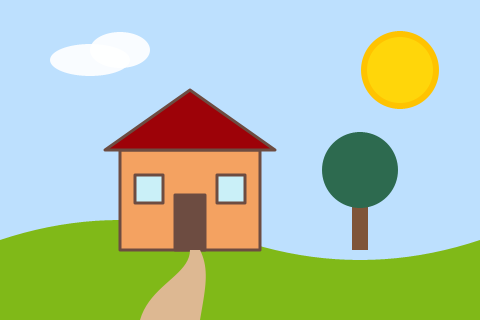

# CSC360 Group 3 — RRR-SVGs: Reading, Rendering, and Rasterization

> **An end-to-end 2D vector graphics engine built from scratch in Java, transforming SVG XML descriptions into discrete, antialiased pixels using custom geometric interpretation, Bézier curve flattening, and scanline rasterization.**

<p align="center">
  
  <br>
  <em>Figure 1: Custom vector-rendered and rasterized output generated by our 4-stage pipeline from <code>samples/house.svg</code>.</em>
</p>

---

## 🏗️ Architectural Pipeline (How It Works)

The pipeline transforms human-readable SVG text into discrete pixels through 4 decoupled stages:

```
[ SVG File / Code ]
        │
        ▼
┌─────────────────────────────────┐
│ 1. SVG READER (Prasham)         │ ➔ W3C DOM Parsing, Syntax Validation & Tree Generation
└─────────────────────────────────┘
        │ SvgNode Tree
        ▼
┌─────────────────────────────────┐
│ 2. SVG INTERPRETER (Bhavya)     │ ➔ viewBox Mapping, 2D Affine Transforms & Cascading Styles
└─────────────────────────────────┘
        │ Normalized Shapes
        ▼
┌─────────────────────────────────┐
│ 3. RENDERING ENGINE (Pranel)    │ ➔ Bézier Curve Flattening, Fill/Stroke Separation, DrawOps
└─────────────────────────────────┘
        │ Polygons & Layer Order
        ▼
┌─────────────────────────────────┐
│ 4. RASTERIZATION (Shubham)      │ ➔ Scanline Pixel Fill, Antialiasing, Blending & PNG Export
└─────────────────────────────────┘
        │
        ▼
[ Rendered PNG / Framebuffer ]
```

---

## 📁 Repository Structure

To satisfy both interactive application requirements and scientific image verification, the repository is organized into two specialized Maven modules:

```text
CSC360-Group3/
├── README.md                          # Project documentation and team matrix
│
├── rrr-svgs-app/                      # Module A: Interactive JavaFX Studio (Pure Custom Engine)
│   ├── pom.xml                        # JavaFX & JUnit dependencies
│   ├── samples/                       # Suite of test SVG files (house, shapes, invalid, etc.)
│   └── src/
│       ├── main/java/com/rrrsvg/
│       │   ├── App.java               # JavaFX Desktop Application GUI & Live Code Editor
│       │   ├── reader/                # [Member 1 - Prasham] SvgReader, SvgNode, SvgParseException
│       │   ├── interpreter/           # [Member 2 - Bhavya] SvgInterpreter, Transform, ColorParser
│       │   ├── renderer/              # [Member 3 - Pranel] Renderer, DrawOp, Shape tessellation
│       │   └── rasterizer/            # [Member 4 - Shubham] Rasterizer (Scanline fill, AA, PNG export)
│       └── test/java/com/rrrsvg/
│           └── RrrSvgTest.java        # Automated tests verifying the full pipeline
│
└── rrr-svgs/                          # Module B: ImageJ Verification & Analytics Suite
    ├── pom.xml                        # ImageJ (ij.jar), Batik, & JUnit dependencies
    └── src/
        ├── main/java/com/rrrsvg/
        │   ├── App.java               # Swing Desktop Viewer Launcher
        │   ├── SVGReader.java         # Module 1 Standalone CLI Tree Inspector
        │   ├── parser/                # DOM Parser & Validation Engine
        │   ├── model/                 # Typed SVG Elements (SVGCircle, SVGRect, SVGPath, etc.)
        │   ├── analysis/              # ImageJ PixelAnalyzer, Histograms & Channel Statistics
        │   ├── raster/                # Rasterizer & CLI Verification Demo
        │   └── ui/                    # Swing GUI: PixelInspector, HistogramView, ComparisonPanel
        └── test/java/com/rrrsvg/      # Automated tests verifying pixel consistency & ImageJ models
```

---

## ⚙️ Features & Mathematical Algorithms

### 1. Reading & Error Trapping
* **Namespace-Aware DOM Builder:** Disables external DTD resolution to prevent network delays and security vulnerabilities.
* **Dual-Layer Validation:**
  * *Syntactic:* Traps unclosed tags, illegal characters, and syntax bugs via `SAXParseException` with line-number diagnostics.
  * *Semantic:* Enforces root `<svg>` element check, immediately rejecting HTML or foreign XML documents.

### 2. Geometry & Coordinate Processing
* **Homogeneous 2D Transformation Matrices:**
  $$\begin{bmatrix} x' \\ y' \\ 1 \end{bmatrix} = \begin{bmatrix} a & c & e \\ b & d & f \\ 0 & 0 & 1 \end{bmatrix} \begin{bmatrix} x \\ y \\ 1 \end{bmatrix}$$
  Supports `translate(tx, ty)`, `scale(sx, sy)`, `rotate(deg, cx, cy)`, and raw `matrix(a,b,c,d,e,f)`.
* **viewBox Mapping:** Automatically scales and centers content using uniform scaling (`meet` aspect ratio).

### 3. Rendering & Curve Flattening
* **Bézier Curve Flattening:** Implements parametric evaluation for cubic and quadratic Bézier curves (`C`, `S`, `Q`, `T` path commands):
  $$B(t) = (1-t)^3 P_0 + 3(1-t)^2 t P_1 + 3(1-t) t^2 P_2 + t^3 P_3, \quad t \in [0, 1]$$
* **Stroke Expansion:** Converts stroked lines and boundary paths into closed polygon loops for the rasterizer.

### 4. Rasterization & Antialiasing
* **Scanline Polygon Fill:** Uses horizontal scanline traversal with edge intersection sorting and the **Even-Odd parity rule** to determine inside/outside state.
* **Sub-Pixel Antialiasing:** Computes fractional pixel coverage along polygon boundaries to eliminate "staircase" jagged edges.
* **Alpha Blending:** Computes transparent overlays using the **Porter-Duff "Over" operator**:
  $$C_{result} = C_{src} \cdot \alpha_{src} + C_{dst} \cdot (1 - \alpha_{src})$$

---

## 🚀 Quick Start & How to Run

### System Requirements
* **Java Development Kit (JDK):** Version 21 or higher.
* **Maven:** Version 3.8+ (or use the Maven bundled in IntelliJ IDEA).

---

### Method 1: Interactive JavaFX Studio (`rrr-svgs-app`)
The primary desktop application featuring live SVG editing, instant custom rendering, and PNG export.

```bash
# 1. Navigate to the application module
cd rrr-svgs-app

# 2. Launch the JavaFX application
mvn javafx:run
```

**Using the App:**
1. Click **Open** to load any sample from the `samples/` folder (e.g. `house.svg`).
2. Edit or type new SVG XML code in the left-hand text editor.
3. Click **Render** to execute your custom 4-stage pipeline and view the result.
4. Click **Save PNG** to export the rendered canvas to a high-resolution PNG file.

---

### Method 2: ImageJ Analytics & Verification Suite (`rrr-svgs`)
The scientific suite featuring ImageJ pixel inspection, RGB histograms, and channel statistics.

```bash
# 1. Navigate to the analytics module
cd rrr-svgs

# 2. Launch the ImageJ Swing Desktop Viewer
mvn compile exec:java -Dexec.mainClass="com.rrrsvg.App"

# 3. Or run standalone CLI demos:
mvn compile exec:java -Dexec.mainClass="com.rrrsvg.SVGReader"                  # Module 1 Reader Tree Demo
mvn compile exec:java -Dexec.mainClass="com.rrrsvg.raster.RasterizerCliDemo"   # Module 3 Raster & Pixel Stats
```

---

## 🧪 Automated Testing Suite

The repository contains **42 automated JUnit tests** verifying parsing resilience, geometric transforms, scanline fill, and raster accuracy.

```bash
# Run tests for rrr-svgs-app
cd rrr-svgs-app && mvn test

# Run tests for rrr-svgs
cd ../rrr-svgs && mvn test
```

### Test Suite Coverage
* `testReaderParsesValidSvg`: Verifies DOM tag parsing and attribute extraction.
* `testReaderRejectsMalformedXml`: Verifies line-numbered error throwing on broken XML.
* `testReaderRejectsNonSvgRoot`: Verifies rejection of non-SVG documents.
* `testInterpreterTransforms`: Validates scale, rotate, and translation matrix concatenation.
* `testScanlineRasterizer`: Validates pixel fill correctness and color assignments.
* `testImageJConsistency`: Asserts image dimensions, luminance, and histogram data integrity.

---

## 🎨 Sample Gallery Suite

Test SVG files are located in [`rrr-svgs-app/samples/`](rrr-svgs-app/samples/):

| Sample File | Key SVG Features Tested |
| :--- | :--- |
| [`house.svg`](rrr-svgs-app/samples/house.svg) | **Full scene:** Bézier rolling hills, `<polygon>` roof, grouped objects (`<g>`), translations, and opacity. |
| [`shapes.svg`](rrr-svgs-app/samples/shapes.svg) | **Primitives checklist:** `<rect>`, `<circle>`, `<ellipse>`, `<line>`, `<polyline>`, and `<polygon>`. |
| [`sample.svg`](rrr-svgs-app/samples/sample.svg) | **Coordinate test:** ViewBox scaling, strokes, and fills. |
| [`invalid.svg`](rrr-svgs-app/samples/invalid.svg) | **Error handling benchmark:** Malformed unclosed tag to verify error catching. |

---

## 👥 Team Members & Responsibilities

The project is structured according to the course rubric across four dedicated modules, ensuring strict separation of concerns:

| Member | Module / Role | Focus Area | Deliverable |
| :--- | :--- | :--- | :--- |
| **Prasham** | **Member 1 — SVG Reader** | *Reading & Validation* | Structured in-memory DOM representation (`SvgNode`) |
| **Bhavya** | **Member 2 — SVG Interpreter** | *Rendering Preparation* | Normalized graphical objects ready to be drawn |
| **Pranel** | **Member 3 — Rendering Engine** | *Geometry & Layering* | Drawable geometry with correct appearance & ordering |
| **Shubham** | **Member 4 — Rasterization Engine** | *Pixel Generation & Export* | Final discrete raster image (PNG buffer) |

### Detailed Member Responsibilities & Rubric Mapping

```
┌────────────────────────────────────────────────────────────────────────────────────────┐
│ 1. Prasham (Member 1) — SVG Reader [Reading]                                           │
├────────────────────────────────────────────────────────────────────────────────────────┤
│ • Read SVG files from disk, streams, or strings.                                       │
│ • Parse XML using Java's built-in W3C DOM parser (DocumentBuilderFactory).             │
│ • Understand SVG elements, nested tags, and XML attributes.                           │
│ • Build a lightweight in-memory DOM/tree representation (SvgNode).                     │
│ • Validate SVG structure: catch malformed XML line numbers & reject non-SVG roots.     │
│ ➔ DELIVERABLE: Structured representation of the SVG that downstream modules consume.   │
├────────────────────────────────────────────────────────────────────────────────────────┤
│ 2. Bhavya (Member 2) — SVG Interpreter [Rendering Preparation]                         │
├────────────────────────────────────────────────────────────────────────────────────────┤
│ • Interpret SVG primitives: circles, rectangles, lines, ellipses, polygons, paths.     │
│ • Resolve coordinate systems, dimensions, and abstract viewBox-to-viewport mapping.    │
│ • Handle styling: fill colors, border/stroke colors, stroke widths, and opacities.     │
│ • Calculate 2D affine transformations (translate, scale, rotate, matrix) and inherit.  │
│ • Convert parsed elements into drawable geometric objects.                             │
│ ➔ DELIVERABLE: Collection of normalized graphical objects ready to be rendered.        │
├────────────────────────────────────────────────────────────────────────────────────────┤
│ 3. Pranel (Member 3) — Rendering Engine [Rendering]                                    │
├────────────────────────────────────────────────────────────────────────────────────────┤
│ • Develop the logic to prepare and process graphical objects for drawing.              │
│ • Handle shape boundaries, geometry tessellation, and Bézier curve flattening.         │
│ • Separate and handle fill operations and stroke boundary operations.                  │
│ • Manage overlapping objects and enforce SVG document drawing order (Painter's order). │
│ • Generate an intermediate polygon representation (DrawOp) for rasterization.          │
│ ➔ DELIVERABLE: Drawable geometry with correct visual appearance and layering.          │
├────────────────────────────────────────────────────────────────────────────────────────┤
│ 4. Shubham (Member 4) — Rasterization Engine [Rasterization]                           │
├────────────────────────────────────────────────────────────────────────────────────────┤
│ • Convert continuous graphical geometry into discrete pixels on a 2D framebuffer.      │
│ • Determine pixel coverage using high-speed Scanline Polygon Fill (Even-Odd parity).   │
│ • Assign and blend colors to pixels using Porter-Duff Over alpha compositing.          │
│ • Implement sub-pixel anti-aliasing for smooth, stair-free diagonal edges and curves.  │
│ • Generate and encode the final raster image into standard PNG format.                 │
│ ➔ DELIVERABLE: A crisp raster image generated directly from vector input.              │
└────────────────────────────────────────────────────────────────────────────────────────┘
```

---

## 📜 Academic Integrity & Course Information

* **Course:** CSC360 / Computer Graphics & Image Processing
* **Project:** RRR-SVGs (Reading, Rendering, and Rasterization)
* **Group:** Group 3
* **Repository:** `CSC360-Group3`
